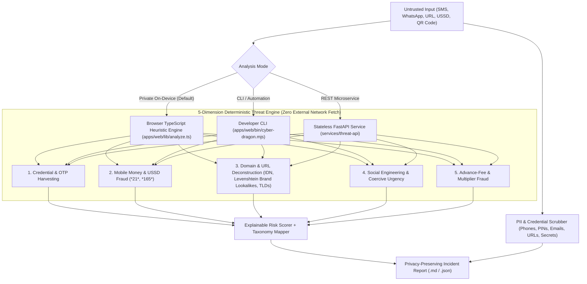

# 🐉 Cyber Dragon v1.0 — Community Cyber Defense & Digital Fraud Intelligence

[](https://github.com/codesphere-u/cyber-dragon/actions/workflows/ci.yml)
[](LICENSE)
[](https://cyber-dragon-ivory.vercel.app)

**Explainable, privacy-preserving defensive cybersecurity platform for identifying phishing links, IDN homograph attacks, and East African Mobile Money & USSD social engineering.**

> **Advisory Safeguard:** Cyber Dragon performs deterministic, SSRF-free static and structural analysis. It never visits or fetches submitted URLs, never stores user submissions, and never certifies a message or URL as guaranteed safe.

---

## 1. Why Cyber Dragon Exists

Digital fraud targeting mobile-first communities frequently bypasses traditional desktop phishing filters. Instead of relying solely on email attachments, attackers combine:
- **Fake Mobile Money Reversal Lures:** Sending spoofed SMS deposit alerts and pressuring victims to "return" funds or enter their MoMo/Airtel Money PIN.
- **USSD Call & OTP Forwarding Traps:** Coercing users into dialing `*21*<number>#` or `*62*<number>#` under the guise of SIM registration orUCC compliance, silently diverting incoming verification calls and OTPs.
- **Brand Combo-Squatting & IDN Homographs:** Using lookalike domains (`stanbic-uganda-verify.top`, `mtn-claim.xyz`, `xn--pple-43d.com`) paired with open-redirect parameters.
- **Advance-Fee Grant & Tax Refund Scams:** Demanding upfront mobile-money clearance fees to unlock fabricated youth grants or lottery rewards.

**Cyber Dragon** gives individuals, community responders, and developers an explainable, zero-network-fetch analysis workbench, a developer CLI, and a stateless FastAPI microservice.

---

## 2. System Architecture



---

## 3. Core Capabilities

| Capability | Implementation Details |
| :--- | :--- |
| **5-Dimension Explainable Risk Scoring** | Computes an overall `0–100` advisory score alongside sub-scores for `credential_harvesting`, `mobile_money_ussd_fraud`, `domain_url_deception`, `social_engineering_urgency`, and `advance_fee_investment_scam`. |
| **Brand-Impersonation & Homograph Detection** | Inspects URLs against 18+ protected African & global brands (MTN, Airtel, M-Pesa, Stanbic, Centenary, Equity, Flutterwave, Paystack, Chipper, URA, NSSF, WhatsApp, Telegram, Google, Microsoft, Apple, PayPal, Binance) using edit-distance lookalike analysis, Punycode (`xn--`), and high-abuse TLD checks—while allowing official root domains. |
| **USSD Call/OTP Diversion Detection** | Flags unconditional call/SMS forwarding strings (`*21*`, `*61*`, `*62*`, `*67*`) and parameterized mobile-money transfer strings (`*165*`, `*185*`), providing immediate cancellation guidance (`##002#`). |
| **PII-Redacting Incident Reports** | Automatically scrubs phone numbers (`+256...`, `07...`), 4–8 digit numeric PINs/OTPs, email addresses, USSD codes, and URL query tokens before generating exportable Markdown or JSON incident briefs. |
| **On-Device QR Code Inspection** | Decodes QR images locally in the browser (`BarcodeDetector`) and analyzes the destination URL without visiting it. |

---

## 4. Quick Start

### 4.1 Run the Web Security Workbench & Developer CLI (`apps/web`)

Requires **Node.js 22+**.

```bash
cd apps/web
npm install
npm test
npm run benchmark
npm run dev
```

Open `http://localhost:3000` to use the interactive workbench, or run the CLI directly:

```bash
# Scan a suspicious Mobile Money or USSD message
node --experimental-strip-types bin/cyber-dragon.mjs scan "URGENT: Dial *21*0772112233# to prevent SIM deactivation"

# Generate a PII-redacted Markdown incident report
node --experimental-strip-types bin/cyber-dragon.mjs report "Wrongly sent UGX 450,000. Call +256772123456 or send PIN 4829"

# Run the 8-scenario synthetic threat benchmark suite
npm run benchmark
```

### 4.2 Run the FastAPI Threat Microservice (`services/threat-api`)

Requires **Python 3.11+**.

```bash
cd services/threat-api
python3 -m venv .venv
source .venv/bin/activate
pip install -r requirements.txt
pytest -v
uvicorn app.main:app --reload --port 8000
```

Interactive OpenAPI documentation is served at `http://127.0.0.1:8000/docs`.

#### Example API Calls

```bash
# 1. Single explainable threat analysis
curl -s -X POST http://127.0.0.1:8000/api/v1/analyze \
  -H "Content-Type: application/json" \
  -d '{"text": "Verify your account at https://stanbic-uganda-verify.top/login?redirect=portal"}' | jq

# 2. Generate a PII-redacted incident report
curl -s -X POST http://127.0.0.1:8000/api/v1/incident-report \
  -H "Content-Type: application/json" \
  -d '{"text": "I wrongly sent UGX 250,000 by mistake. Call +256772998877 or enter PIN 4321."}' | jq

# 3. Batch corpus scan
curl -s -X POST http://127.0.0.1:8000/api/v1/analyze/batch \
  -H "Content-Type: application/json" \
  -d '{"items": ["URGENT! Send your OTP now.", "Team meeting at 10am tomorrow."]}' | jq
```

---

## 5. Verified Benchmark Results

Executed via `npm run benchmark` across the 8 curated threat & control scenarios:

| Scenario ID | Threat Pattern | Expected Level | Actual Level | Score | Latency |
| :--- | :--- | :---: | :---: | :---: | :---: |
| `momo-reversal-pin` | MTN MoMo Fake Reversal & PIN Lure | `high` | `high` | 92 / 100 | < 1.2 ms |
| `ussd-call-diversion` | USSD `*21*` Call & OTP Forwarding Hijack | `high` | `high` | 100 / 100 | < 0.5 ms |
| `brand-lookalike-phish` | Stanbic Lookalike Domain + `.top` TLD + Redirect | `high` | `high` | 100 / 100 | < 0.5 ms |
| `idn-punycode-homograph` | IDN Punycode (`xn--`) Domain Alert | `elevated` | `elevated` | 55 / 100 | < 0.4 ms |
| `ura-advance-fee-grant` | Fake Youth Grant Advance-Fee Scam | `high` | `high` | 77 / 100 | < 0.1 ms |
| `whatsapp-otp-takeover` | WhatsApp 6-Digit Verification Hijack | `high` | `high` | 60 / 100 | < 0.1 ms |
| `crypto-multiplier-ponzi` | Guaranteed Daily Crypto Multiplier | `elevated` | `elevated` | 40 / 100 | < 0.1 ms |
| `benign-colleague-note` | Ordinary Colleague Meeting Note (Control) | `unknown_or_low_indicators` | `unknown_or_low_indicators` | 0 / 100 | < 0.1 ms |

---

## 6. Documentation

- [System Architecture](docs/architecture.md)
- [ADR-001: SSRF-Free Static Heuristic Architecture](docs/decisions/001-ssrf-free-static-heuristics.md)
- [Testing & Verification Guide](docs/testing.md)
- [Privacy & Heuristic Limitations](docs/limitations.md)
- [Security Operations](docs/SECURITY_OPERATIONS.md)
- [Changelog](CHANGELOG.md)
- [Contributing](CONTRIBUTING.md) · [Code of Conduct](CODE_OF_CONDUCT.md) · [Security Policy](SECURITY.md)

## 7. License

Licensed under the [Apache License 2.0](LICENSE).
